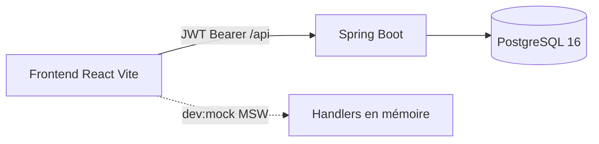

# Présentation FitCoach — texte prêt à lire

Livrable : script oral + parcours démo. Mode démo recommandé : `cd frontend && npm run dev:mock` (comptes `athlete@fitcoach.dev` / `coach@fitcoach.dev`, mot de passe `Password1`).

---

## 1. Pitch (30 s)

FitCoach est une plateforme fitness qui relie **athlètes** et **coachs** : carnet d’entraînement, programmes, planning, stats, réservation de créneaux et messagerie. C’est un **monolithe modulaire** découpé par domaine métier (même découpage front et back), pour limiter les conflits de merge en équipe.

---

## 2. Architecture et code

- **Backend** : packages `com.fitcoach.*` (`identity`, `catalog`, `program`, `training`, `planning`, `stats`, `coaching`, `booking`, `messaging`…). Chaque module a typiquement `domain / dto / repository / service / web`.
- **Frontend** : miroir dans `frontend/src/features/<module>/` (`api`, `hooks`, `pages`, `schemas`). Routes TanStack dans `src/routes/`, shell dans `src/app/layouts/app-shell/`.
- **Contrat partagé** : OpenAPI Spring (`/v3/api-docs`) → types générés (`npm run gen:api`) → client `openapi-fetch`.
- **Schéma DB** : Flyway uniquement (`ddl-auto: validate`), migrations `V1`…`V10`.
- **Sécu** : JWT stateless, rôles `ATHLETE` / `COACH` / `ADMIN`, `@PreAuthorize` sur les endpoints sensibles.

---

## 3. Technologies

| Couche | Stack |
| --- | --- |
| Backend | Java 21, Spring Boot 4.1, Spring Security, JPA, Flyway, springdoc-openapi, JWT (jjwt), Lombok, Gradle |
| Données | PostgreSQL 16 (citext, pgcrypto, contraintes d’exclusion pour le booking), Docker Compose + pgAdmin |
| Frontend | React 19, TypeScript, Vite 8, TanStack Router + Query, Zustand, Zod + RHF, Tailwind 4 + shadcn/Radix, MSW |
| Qualité | Tests Gradle + Vitest/Testing Library ; CI frontend (lint, typecheck, tests, build) |

---

## 4. Features livrées (avec angle technique)

À dire à voix haute, 1–2 phrases par feature :

- **Auth & profil** — Inscription/connexion JWT (BCrypt), session Zustand persistée côté front, guards de routes ; profil + avatar multipart.
- **Catalogue** — CRUD exercices/tags/muscles ; écriture réservée COACH/ADMIN.
- **Programmes** — CRUD jours/exercices, duplication, notations, lien public `/api/programs/shared/{token}`.
- **Carnet d’entraînement** — Séances + séries (charge, reps, RPE), volume calculé, records personnels.
- **Planning** — Calendrier semaine : planifier, reporter, skip, compléter ; validation coach des séances.
- **Stats** — Agrégations SQL (overview, volume, streak, adhérence, distribution musculaire, score de progression) + graphiques front.
- **Coaching (partiel)** — Liaison coach↔athlète par email, posts (images protégées JWT) ; pas encore le cycle d’invitations complet.
- **Réservation** — Créneaux coach sans chevauchement (contrainte exclusion Postgres) ; réservation/annulation athlète.
- **Messagerie** — Conversations 1–1, messages paginés par curseur, marquage lu.
- **Shell UI** — Sidebar par rôles, menu Ctrl+K, thème, toasts, mode mock MSW pour démo sans backend.

---

## 5. Ce qu’il reste à implémenter

D’après le checklist README :

- **Phase 8 (coaching)** — Finaliser : invitations PENDING/refus, notes coach, tableau de suivi riche.
- **Phase 11 — Gamification** — Badges, XP, défis (stub package + page « En construction »).
- **Phase 12 — IA** — Génération de programmes (stub).
- **Phase 13 — Nutrition** — Bonus (stub).
- **Phase 14 — Admin / CI / déploiement** — Back-office, Testcontainers, pipeline backend, deploy.
- **Bonus technique** — API poids corporel (table déjà en migration, pas d’API Java).

---

## 6. Chemin de démo (écran partagé, ~5–7 min)

Préparer avant : `npm run dev:mock` → http://localhost:5173. Optionnel : Swagger http://localhost:8080/swagger-ui.html si le back tourne.

1. **Login athlète** — `athlete@fitcoach.dev` / `Password1` → dashboard (stats + activité récente).
2. **Training** — Ouvrir une séance / montrer séries et PRs.
3. **Planning** — Vue semaine, séance du jour (compléter / skip si données seed).
4. **Programmes + Catalogue** — Structure d’un programme ; filtres catalogue.
5. **Stats** — Courbes volume / muscles / streak.
6. **Logout → Login coach** — `coach@fitcoach.dev` / `Password1`.
7. **Coaching** — Liste athlètes, posts, validations en attente.
8. **Booking** — Créneaux coach ; (si temps) repasser athlète pour réserver.
9. **Messagerie** — Conversation + envoi d’un message.
10. **Placeholder** — Ouvrir AI ou Gamification (« En construction ») pour montrer le backlog.
11. **(Optionnel code)** — Arborescence `com.fitcoach` + `features/`, Swagger, un handler MSW.

Phrase de clôture : *« Le cœur athlete/coach est opérationnel ; coaching avancé, IA, gamification, nutrition et admin restent à livrer. »*
